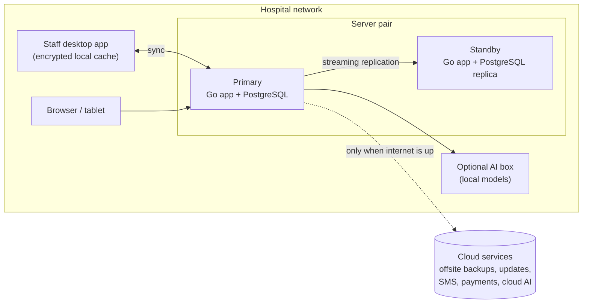

# HIS Revamp Plan

**Goal:** rebuild the Integrated Health Care Management System (HIS) as a commercial product that runs on servers inside hospitals and clinics in Ghana. It covers the full business of a facility, has AI assistance built in, and keeps working when the internet, the hospital network or the server goes down.

**Phase 1 (this plan):** staff-facing system covering clinical, administrative and financial work, plus AI features and offline resilience.
**Phase 2 (later):** patient portal, telemedicine, online booking, and a cloud hub linking several facilities.

---

## 1. Where we are today

The current system comes from our 2024 final-year project. Its code is in three places:

| Branch | Contents |
|---|---|
| `main` | Static HTML/Tailwind mockups only |
| `origin/New-Frontend` | Newer mockups |
| `origin/backend` | The working Django app (users, patients, appointments, medicals) on SQLite |

The thesis describes more than the code does:

| Thesis says | Code does |
|---|---|
| Doctor, nurse, admin and patient roles | Doctor = any staff user; no nurse role; admin is Django's built-in admin |
| Medication reminders via Rapid Pro | Not built. Reminders are a manual to-do list |
| Chat with doctors | Mockup page only |
| Encryption, HIPAA/GDPR compliance | None. Any logged-in user can open another patient's records by changing the URL; the add-diagnosis view has no login check |
| Lab investigations | Orders only; there's nowhere to record results |
| Google Meet telemedicine | Each user's own Google login, tokens stored in the browser session |

Data problems we must not copy:
- Diagnoses, medicines and referral hospitals are hard-coded short lists.
- Vital signs are stored as free text (blood pressure as `"120/80"`).
- A doctor's time slot must be unique across the whole system.
- Bookings link patients by a text ID instead of a database relationship.

**Decision:** this is a rebuild, not a port. The thesis data model and the user-manual screens are our starting spec; the Django code is reference only.

---

## 2. Guiding principles

1. **On-premises first.** Each facility runs its own server. The internet is a bonus, never a requirement for clinical work.
2. **Keeps working offline at every level.** Losing the internet, the network or the server slows work down but never stops it.
3. **Simple to install and support.** One application binary plus PostgreSQL. A hospital IT person, or our remote support, can install and update it.
4. **Clinical data is never silently lost or overwritten.** Every change is recorded and attributed to someone.
5. **AI assists, people decide.** Every AI output is a suggestion a clinician or staff member accepts, edits or rejects.
6. **Built for Ghana.** NHIS, Ghana Card, mobile money, local SMS providers, DHIMS2 reporting, Act 843.

---

## 3. Architecture overview

- **Server:** a single Go binary that serves the API and the React frontend, backed by PostgreSQL. Larger hospitals get a standby server that takes over if the primary fails.
- **Staff desktop app:** the same React UI in a desktop shell, with an encrypted local database so staff can keep working when they can't reach the server.
- **Browser access:** any device on the hospital network can use the system through a browser when the server is reachable.
- **Cloud (optional):** offsite backups, software updates, SMS, payments and cloud AI. Nothing clinical depends on it.

---

## 4. Phase 1 modules: the full hospital business

### Foundation
- **Users, roles and permissions:** doctor, nurse, front desk/records, pharmacist, lab scientist, radiographer, cashier, billing/claims officer, stores, facility admin. Permissions are granular and configurable per facility.
- **Facility setup:** departments, wards and beds, services and price lists, staff schedules.
- **Audit log:** who viewed, created or changed what, and when, for every record.
- **Master data:** ICD-10 diagnosis codes, a drug formulary (Ghana Essential Medicines List and NHIS medicines list), lab tests with reference ranges, NHIS service tariffs.

### Patient flow
- **Registration:** Ghana Card or NHIS number lookup, duplicate detection, a printed patient card with a QR code.
- **Outpatient (OPD):** check-in, vitals, triage, the doctor's queue, consultation notes, diagnoses, orders, follow-up booking.
- **Appointments:** doctor availability per slot, booking, rescheduling, cancellation, SMS reminders.
- **Emergency:** fast-track registration (registration can be completed later), triage priority, handover to OPD or admission.
- **Inpatient (IPD):** admissions, bed management, ward rounds, nursing notes, a medication administration record showing what was given and when, transfers, discharge summaries.
- **Maternity and theatre:** antenatal visits, delivery records, theatre booking and operation notes. This can come late in Phase 1.

### Clinical services
- **Laboratory:** test orders, sample tracking with barcodes, result entry with reference ranges, abnormal flags, verification, printed reports.
- **Radiology/imaging:** orders, reports and attached images. Full medical-image (DICOM/PACS) integration comes later.
- **Pharmacy:** prescriptions arrive from the consultation; staff dispense, record partial fills and substitutions, and see interaction and allergy alerts.

### Business and operations
- **Billing and cashier:** charges added automatically from services, drugs and tests; invoices; cash, mobile money and card payments; receipts; deposits for inpatients.
- **NHIS and insurance claims:** NHIS eligibility check, claim preparation with ICD-10 and G-DRG codes, batch submission in the NHIA e-claims format, rejection tracking. Private insurance schemes too.
- **Inventory and stores:** stock for pharmacy and consumables, batches and expiry dates, reorder levels, purchase orders, supplier records, transfers between stores.
- **Reports:** daily census, revenue, disease statistics, DHIMS2 export for Ghana Health Service, NHIS claims summary.
- **Notifications:** SMS for appointments, medication reminders, lab results ready, payment receipts.
- **Printing:** prescriptions, lab requests and results, receipts, discharge summaries, patient cards.

### Phase 2 (deferred)
Patient portal and mobile app, telemedicine (self-hosted LiveKit or Jitsi), online booking, a cloud hub for groups with several facilities, FHIR data exchange.

---

## 5. AI features

AI runs at three levels, so the useful parts survive without internet:

| Level | Where it runs | Works offline? | Used for |
|---|---|---|---|
| Rules engine | Inside the Go server | Yes | Drug interactions, allergy alerts, dose limits, abnormal-result flags, claim completeness checks |
| Local models | Hospital server or an optional GPU "AI box" | Yes | Speech-to-text dictation, note summarisation, coding suggestions, forecasting |
| Cloud LLM | External API, only when the internet is up | No (degrades gracefully) | Heavier summarisation and drafting where local models aren't good enough |

### Planned features (by value)
1. **Voice dictation for clinical notes:** the doctor speaks; local speech-to-text (whisper.cpp) produces a draft note the doctor edits.
2. **ICD-10 code suggestions** from the consultation note, plus a check that the diagnosis matches the prescriptions. This improves both records and NHIS claims.
3. **Claim scrubbing:** before submission, flag NHIS claims likely to be rejected (missing codes, tariff mismatches, eligibility problems).
4. **Patient history summary:** a one-screen summary of past visits, chronic conditions, current medications and recent results when a doctor opens a patient.
5. **Pharmacy and stores forecasting:** predict drug demand and stock-outs from dispensing history and seasonality, such as malaria season.
6. **Triage risk scoring:** flag deteriorating patients from vital-sign trends (an early-warning score) for nurses on the wards.
7. **No-show prediction:** identify appointments likely to be missed so staff can send extra reminders or overbook.
8. **Plain-English report questions:** managers ask "how many malaria cases last month by ward?" and get a table.

### Guardrails
- AI output is always labelled as a suggestion and needs a person to accept it. Every acceptance and rejection is logged.
- No patient data leaves the facility for a cloud model unless the facility has enabled it, and identifying details are removed first.
- Interaction and allergy alerts come from the rules engine and a curated drug knowledge base, never from an LLM alone.
- Each AI feature can be switched off per facility.
- Before launch, check whether any feature counts as a regulated medical device under Ghana FDA rules.

### How AI fits the stack
- The Go server calls local models through **Ollama** (written in Go, runs on CPU or GPU) and **whisper.cpp** for speech.
- Forecasting and scoring models can be trained in Python offline, exported to ONNX, and run from Go. Python is never needed on hospital servers.
- The cloud LLM is optional and sits behind one internal interface, so we can swap providers.

---

## 6. Offline access and resilience

### What fails and what happens

| Failure | What users experience | How we handle it |
|---|---|---|
| **Internet down** | Nothing changes for clinical work. SMS, payments, cloud AI and backups queue up | Everything clinical runs on the local server; outbound jobs retry automatically |
| **Primary server down** | A short pause (seconds to a minute), then work continues | Standby server with live PostgreSQL replication takes over automatically, using a shared virtual IP address |
| **Both servers down, or the network down** | Desktop app switches to offline mode with a visible banner; staff keep working | Encrypted local database on each workstation; changes queue and sync when the server is back |
| **Workstation dies** | Staff move to another workstation | Unsynced changes are the only risk, so sync runs every few seconds when connected |
| **Total outage (power, everything)** | Paper downtime procedure | The system prints downtime reports regularly (see below) |

### Offline mode on staff workstations
- The **desktop app** (built with **Wails**, a Go + web desktop shell) runs the same React UI and keeps an **encrypted local SQLite database**.
- Each workstation caches only the **working set** it needs, not the whole hospital database. That means:
  - today's queue and appointments for its department
  - currently admitted patients on its wards
  - recently seen patients
  - drug formulary, price lists and lab test catalogue
- Staff can register patients, record vitals, write notes, prescribe, dispense, record results and take payments offline.
- Every record gets a globally unique ID (UUIDv7) created on the device. Offline records never clash with records made elsewhere.

### Sync and conflict rules
Most clinical data only ever gets added (a new vital sign, a new note, a new result), so it never conflicts. Data that can be edited needs explicit rules:

| Data | Rule |
|---|---|
| Vitals, notes, results, prescriptions, dispensing | Add-only; corrections are new entries that reference the old one |
| Patient demographics | Last change wins per field; conflicts are flagged to records staff for review |
| Stock levels | Stored as a ledger of movements, never as one editable number, so offline dispensing from two stations adds up correctly |
| Invoices and receipts | Provisional numbers offline; final numbers assigned by the server on sync |
| Bed assignments, appointment slots | Server decides; if two offline bookings clash, the later one goes to a review queue |

Before building our own sync engine, evaluate existing PostgreSQL sync tools (ElectricSQL, PowerSync). Expect to need custom logic anyway, because the conflict rules are specific to healthcare.

### Securing offline data
- The local database is encrypted (SQLCipher), with the key tied to the logged-in user.
- Devices must be registered before they get a cache, and they can be wiped remotely.
- Offline login uses a cached credential with a time limit; after it expires, the user must reconnect.
- The local cache keeps a limited time window and is cleared when a user signs out of a shared workstation.

### Paper downtime procedure
- Every few hours (configurable), the system prints or saves to PDF a **downtime pack**: ward census, medication administration schedules for the next shift, today's appointments, and allergy lists for admitted patients.
- Printed downtime forms match the system's fields, so data entered later is quick and accurate.

---

## 7. Technology stack

| Area | Choice | Why |
|---|---|---|
| Backend language | **Go** | Single binary, low memory, easy to install and update on hospital servers |
| Web framework | chi or Echo | Lightweight, standard |
| Database | **PostgreSQL** | Reliable, built-in replication, mature tooling |
| Database access | sqlc + pgx | Plain SQL, checked at compile time, fast |
| Migrations | goose or Atlas | Versioned schema changes |
| Background jobs | River (stored in Postgres) | SMS, claims, sync and reports without adding Redis |
| Frontend | **React + TypeScript + Vite** | Static build served from the Go binary; no separate Node server |
| UI | Tailwind + shadcn/ui | Already familiar to us; accessible components |
| Data fetching / routing | TanStack Query + TanStack Router | Caching, retries, offline-aware |
| Forms / validation | React Hook Form + Zod | Complex clinical forms |
| Charts | Recharts or ECharts | Vitals trends, dashboards |
| Desktop app | **Wails** (alternative: Tauri) | Go-based, reuses our Go sync and data code, local SQLite |
| Local storage | SQLite + SQLCipher | Encrypted offline cache |
| High availability | PostgreSQL streaming replication + keepalived | Automatic switch to the standby server |
| AI runtime | Ollama, whisper.cpp, ONNX Runtime | Local, offline-capable |
| SMS | Hubtel, Arkesel or mNotify | Ghanaian providers |
| Payments | MTN MoMo, Paystack or Hubtel | Mobile money and cards |
| Packaging | Docker Compose or binary + systemd, with an installer script | Simple installs |
| Updates | Signed releases with rollback | Safe updates in the field |
| Remote support | Tailscale or WireGuard | Secure access to customer servers |
| Monitoring | Prometheus + Grafana, or a lighter uptime/error tool | Know about problems before customers call |
| CI/CD | GitHub Actions | Automated builds and tests |
| Backups | Automated, encrypted, local + offsite | Restores tested regularly |

---

## 8. Deployment packages

| Package | Hardware | Resilience |
|---|---|---|
| **Clinic** | One small server + UPS; a few desktops | Offline desktop app + nightly offsite backups |
| **Hospital** | Two servers (primary + standby) + UPS; optional GPU AI box | Automatic failover + offline desktop app + offsite backups |

Each install includes the installer, a hardware checklist, a backup and restore runbook, the downtime procedure, and staff training material.

---

## 9. Security and compliance

- **Ghana Data Protection Act 2012 (Act 843):** register with the Data Protection Commission. Document consent, data retention and data-subject access processes. (HIPAA and GDPR from the thesis mostly don't apply to Ghanaian sales; follow them only as good practice.)
- Role-based access with **record-level checks**: no viewing records by guessing IDs.
- 2-factor login for staff; automatic session timeouts on shared workstations.
- HTTPS on the hospital network; encryption at rest on servers, workstations and backups.
- Full audit log, plus "break-glass" emergency access that is logged and reviewed.
- Regular security testing before each major release.

---

## 10. Delivery order

1. **Foundation:** auth, roles, audit log, facility setup, master data, installer, backups.
2. **Patient flow:** registration, OPD, appointments, vitals, triage, consultations.
3. **Clinical services:** lab, pharmacy, radiology orders.
4. **Business:** billing, cashier, NHIS claims, inventory, reports, SMS.
5. **Resilience:** standby server failover, desktop app offline mode, sync, downtime packs.
6. **Inpatient:** admissions, wards, medication administration records, discharge; then maternity and theatre.
7. **AI:** rules engine first (it ships with pharmacy), then dictation, coding suggestions, claim scrubbing, summaries, forecasting.
8. **Pilot** at one clinic, fix, then a hospital pilot.

Design the data model and sync rules for offline mode from step 1, even though the desktop app ships in step 5. Adding offline later to a model that wasn't built for it is very hard.

---

## 11. Open decisions and risks

- **Drug knowledge base:** interaction and allergy checks need a curated database. Commercial ones are expensive; open ones are US-centric. Decide on a source and its licensing early.
- **NHIS integration:** confirm the current NHIA e-claims format and the accreditation process for third-party software.
- **Sync engine:** build our own vs adopt ElectricSQL/PowerSync. Decide after a short prototype.
- **Local AI hardware:** CPU-only is enough for rules and forecasting but slow for dictation and summaries. Decide whether the AI box is standard or an add-on.
- **Medical-device regulation:** confirm with Ghana FDA whether triage scoring or coding suggestions are regulated.
- **Pricing model:** per facility, per bed, or per user; plus support and update subscriptions.
- **Pilot site:** secure a clinic willing to pilot. Their workflows will reshape the module details.
